# Harvester Risk Atlas

**Which wild medicinal plants of the Philippines need attention first, where they grow, why, and how sure we are. Every rank comes with its range, and missing data stays missing.**

[](https://www.python.org/)
[](https://react.dev/)
[](https://www.typescriptlang.org/)
[](https://maplibre.org/)
[](https://harvester-risk-atlas.vercel.app/)
[](https://ethnohack2026.devpost.com/)
[](LICENSE)

**EthnoHack 2026** submission, **Track 3: Biodiversity & Sustainability**. Team: **Yuan Andrei C. Mariano** and **Alicia Jhyle Vilale**.

<p align="center">
  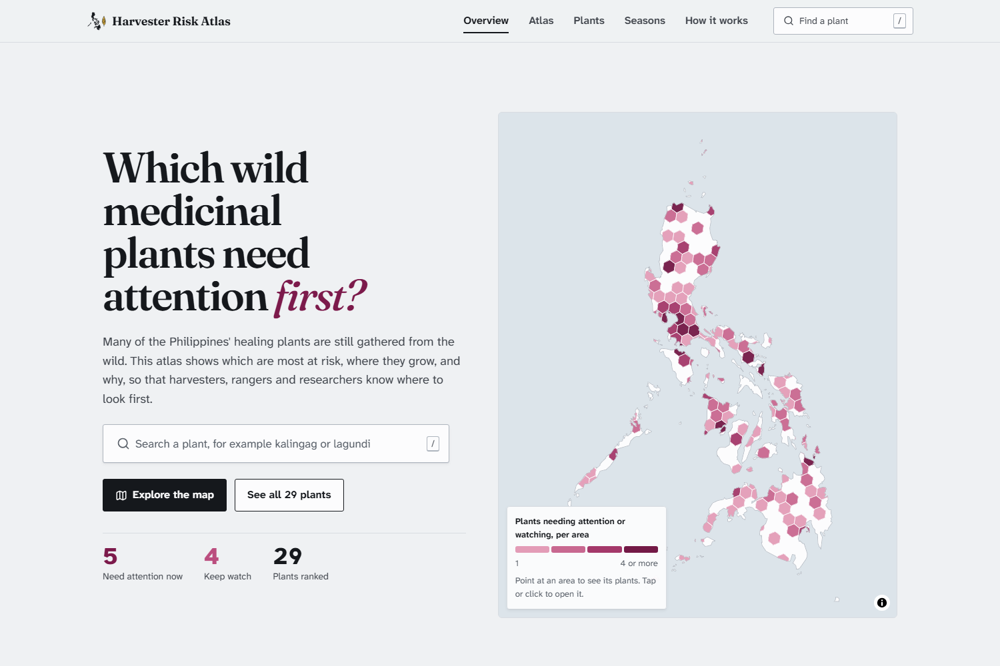
</p>

> **For research and education.** Not medical advice, not a harvest permit, and not a Red List assessment. The atlas ranks plants for conservation attention only. It makes no claims about whether any plant works as a medicine. IUCN and DENR categories are never invented.

---

## Overview

Up to **4 billion people** rely on herbal medicine as their main source of healthcare<sup>[1]</sup>. About **30,000** plant species have documented medicinal uses. Of those in international trade, an estimated **60–90%** are collected from the wild. Only **7%** have been assessed for the IUCN Red List, and **1 in 5** of those assessed is threatened<sup>[2]</sup>.

In the Philippines, **1.47 million hectares** of tree cover were lost between 2001 and 2023, about **175 ha a day**<sup>[3]</sup>. The national threatened-plant list names **1,186** plants<sup>[4]</sup>. But no dataset records how much of each medicinal plant is harvested, so nobody can say which ones are being dug up fastest, or where to look first.

**Harvester Risk Atlas** is a free, static web atlas and a reproducible data pipeline that:

1. Cleans **9,660** Philippine GBIF records down to **4,789** reliable ones, giving each dropped record one recorded reason.
2. Scores **29** native medicinal plants, out of a cohort of 51, on three plain questions: *How hard is it to find? Does harvesting kill it? Is its home disappearing?*
3. Re-runs the ranking **2,000** times with different weights and evidence, so every plant gets a **rank range** and a tier: *Needs attention now*, *Keep watch* or *Lower concern*.
4. Shows plants only as ~250 km² hexagons, never as exact points, and prints a one-page **field brief** for each plant.

One of those plants is **tongkat ali** (*Eurycoma longifolia*). Its roots are dug up and sold, and it is officially Endangered, yet open databases hold only **5 reliable records** of it in the whole country. It ranks **2nd of 29, and could be anywhere from 1st to 5th**. [Open it](https://harvester-risk-atlas.vercel.app/species/eurycoma-longifolia).

---

## Try it now

**Live demo:** [https://harvester-risk-atlas.vercel.app](https://harvester-risk-atlas.vercel.app/)

| Page | Link | What you see |
| --- | --- | --- |
| Overview | [`/`](https://harvester-risk-atlas.vercel.app/) | The hotspot map and the five plants that need attention now |
| Atlas | [`/atlas?sp=eurycoma-longifolia`](https://harvester-risk-atlas.vercel.app/atlas?sp=eurycoma-longifolia) | Where a plant grows, or which plants grow in an area |
| Plant profile | [`/species/eurycoma-longifolia`](https://harvester-risk-atlas.vercel.app/species/eurycoma-longifolia) | Three reasons in plain words, evidence, rank range, sources |
| Field brief | [`/species/eurycoma-longifolia/brief`](https://harvester-risk-atlas.vercel.app/species/eurycoma-longifolia/brief) | One printable A4 page |
| All plants | [`/plants`](https://harvester-risk-atlas.vercel.app/plants) | Every plant by tier, with CSV download |
| How it works | [`/how-it-works`](https://harvester-risk-atlas.vercel.app/how-it-works) | Method, weight explorer, robustness checks, sources |

No login and no backend. All 51 plant records ship as static JSON in `web/public/data/`.

---

## What makes this different

### 1. Rarity that corrects for where people look

A roadside weed collects more records than a forest liana, so raw record counts measure attention as much as rarity. We built a survey-effort layer from all vascular-plant records and measure rarity only in the **332 well-searched hexagons** (≥ 100 records, out of 1,267). There, a missing plant really means it is scarce.

### 2. No rank without its range

A Monte Carlo of **2,000** seeded draws varies the evidence and the weights together:

- **Weights:** a Dirichlet distribution around equal weights.
- **Reporting rate:** a Jeffreys posterior, Beta(k + ½, N − k + ½).
- **Habitat shares:** bootstrapped over occupied cells.

Each plant gets a median rank, a 90% interval and P(top quartile), and that probability sets its tier. When the evidence can't separate two plants, they share a tier.

### 3. Plain words, safe maps, and a page for the field

Readers are rangers, local government staff, harvesters and students. Tiers and reasons are named in plain language. Locations are generalised to H3 hexagons, following GBIF guidance on sensitive species (Chapman 2020). The printable field brief says what people can do, such as taking leaves instead of roots or asking the protected-area office before gathering.

---

### 4. Checked against expert sources, and a plan for where to look next

Every name is matched in **World Flora Online**, the backbone the EthnoHack datasets guide recommends: 50 of 51 matched, all accepted names. Each plant is compared with **Co's Digital Flora of the Philippines** (CDFP), the expert checklist built on the work of botanist Leonardo L. Co. Where they disagree with the atlas, the plant page says so. Each plant page then lists where to look next:

- places the expert flora documents where open data holds no reliable record. For tongkat ali these are Mindoro, Homonhon and Bucas Grande;
- under-searched areas right next to known records. Across the 29 ranked plants, 2,992 of 4,542 neighbouring areas (66%) are under-searched;
- records outside the documented range, which should be double-checked.

<p align="center">
  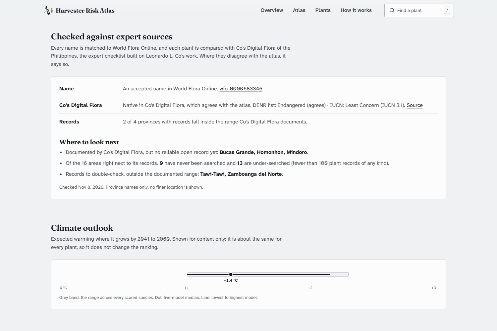
</p>

---

## How it works

<p align="center">
  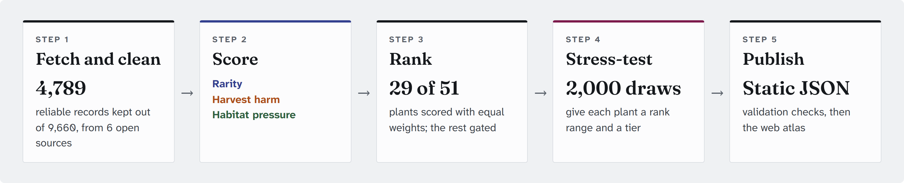
</p>

$$\text{HPI} = \tfrac{1}{3}R + \tfrac{1}{3}H + \tfrac{1}{3}E \qquad (C \text{ shown with weight } 0)$$

| Part | Question | Evidence |
| --- | --- | --- |
| **Rarity (R)** | How hard is it to find? | Effort-corrected reporting rate in well-searched hexagons; number of world regions where WCVP lists it as native |
| **Harvest harm (H)** | Does harvesting kill it? | Part harvested (roots, bark or whole plant score highest), life form and sourcing, cited per plant from Stuart |
| **Habitat pressure (E)** | Is its home disappearing? | Share of occupied hexagons outside protected areas; 2001–2023 forest loss in its provinces, scaled by forest dependence |
| **Climate (C)** | Shown, not scored | CMIP6 2041–2060 warming is about +1.5 °C for every plant, so it cannot separate them |

All parts lie in [0, 1] on fixed anchors, not cohort min–max, so adding a plant never changes another plant's values. A missing part stays missing: the remaining weights rescale and the plant is flagged *partial*. The full method is in [`docs/METHODS.md`](docs/METHODS.md).

---

## Product walkthrough

From a question on the home page to a printed page in the field, following tongkat ali through the app.

**Overview → Atlas → Plant profile → Field brief → How it works → All plants.** Live captures from [harvester-risk-atlas.vercel.app](https://harvester-risk-atlas.vercel.app/).

<table>
<tr>
<td width="50%" valign="top">

<strong>1. Overview</strong><br/>
<br/>
<sub>The question in one line, a hotspot map of plants needing attention or watching, and the counts: 5 need attention now, 4 keep watch, 29 ranked.</sub>

</td>
<td width="50%" valign="top">

<strong>2. Atlas</strong><br/>
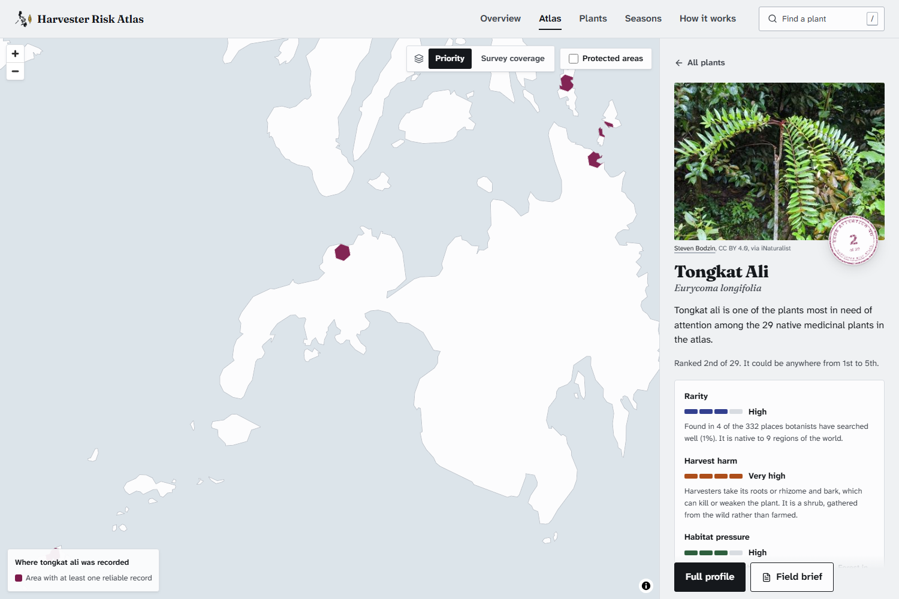<br/>
<sub>Tongkat ali selected: the areas where it was reliably recorded, shown only as ~250 km² hexagons, with its reasons in the side panel.</sub>

</td>
</tr>
<tr>
<td width="50%" valign="top">

<strong>3. Plant profile</strong> (tongkat ali)<br/>
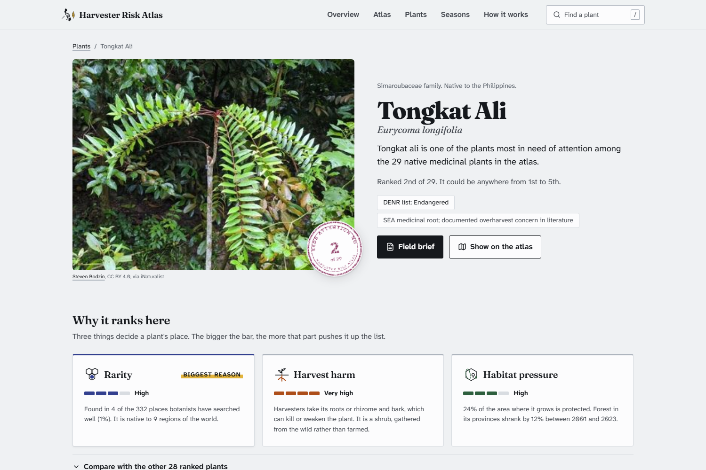<br/>
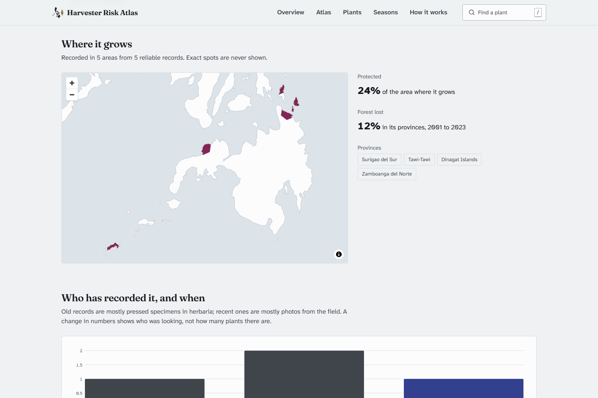<br/>
<sub>"Ranked 2nd of 29. It could be anywhere from 1st to 5th." Rarity is the biggest reason. Below: 24% of where it grows is protected, and forest in its provinces shrank by 12% from 2001 to 2023.</sub>

</td>
<td width="50%" valign="top">

<strong>4. Field brief</strong><br/>
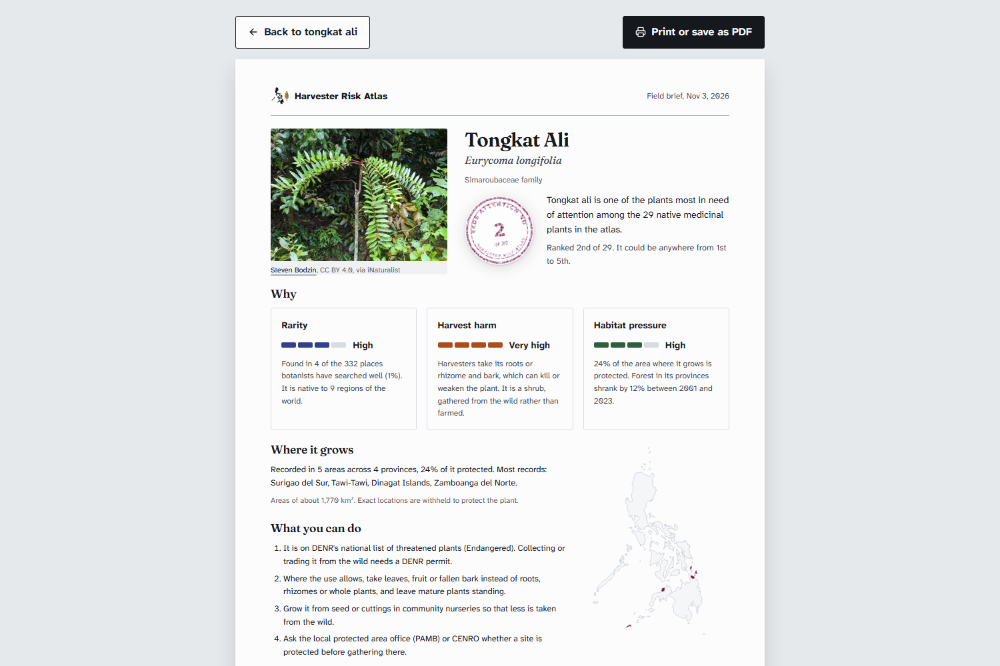<br/>
<sub>One A4 page: why it ranks here, where it grows, and what people can do, such as taking leaves or fruit instead of roots and asking the protected-area office before gathering.</sub>

</td>
</tr>
<tr>
<td width="50%" valign="top">

<strong>5. How it works</strong><br/>
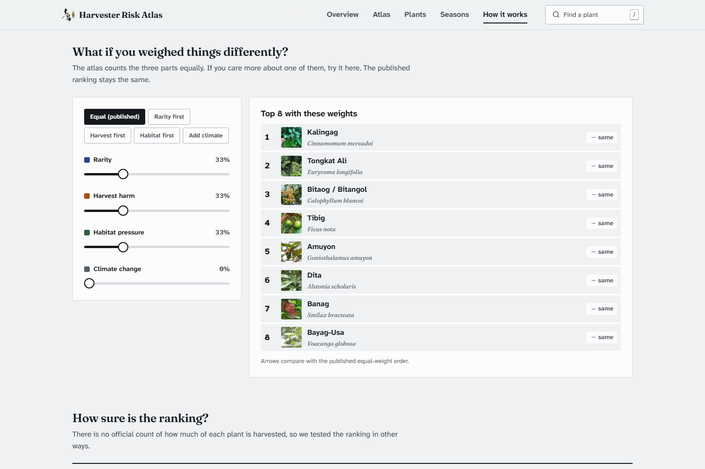<br/>
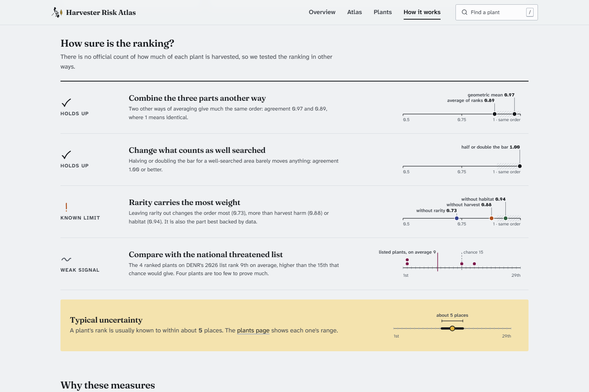<br/>
<sub>Try your own weights and watch the top 8 re-rank live. Then read the checks: two hold up, one known limit, one weak signal, and typical uncertainty of about 5 places.</sub>

</td>
<td width="50%" valign="top">

<strong>6. All plants, and on a phone</strong><br/>
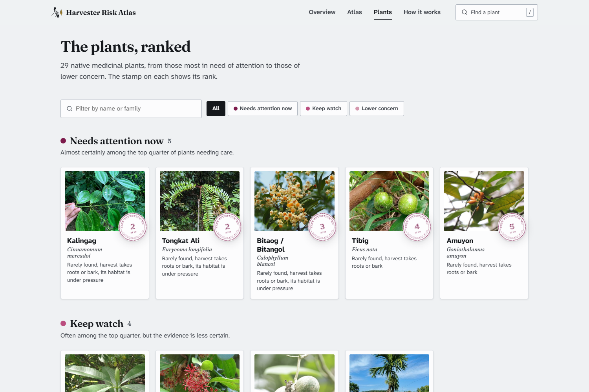<br/>
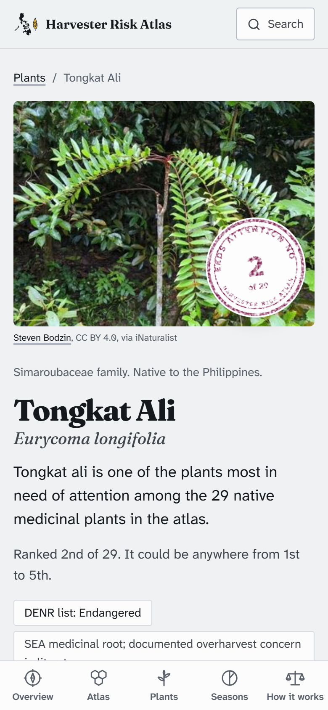<br/>
<sub>Every plant by tier, with CSV download. On a phone, the same pages use a bottom tab bar for use in the field.</sub>

</td>
</tr>
</table>

Regenerate the screenshots (and the slide PDF):

```bash
cd web
npx playwright install chromium
node ../submission/build.mjs
# against a local preview: BASE_URL=http://localhost:4173 node ../submission/build.mjs
```

---

## Results

| Tier | Plants |
| --- | --- |
| **Needs attention now** | 5: kalingag (*Cinnamomum mercadoi*), tongkat ali (*Eurycoma longifolia*), bitaog (*Calophyllum blancoi*), tibig (*Ficus nota*), amuyon (*Goniothalamus amuyon*) |
| **Keep watch** | 4: dita (*Alstonia scholaris*), banag (*Smilax bracteata*), bayag-usa (*Voacanga globosa*), bunga (*Areca catechu*) |
| **Lower concern** | 20 |
| **Not ranked** | 22: not native according to WCVP, or recorded in fewer than 5 hexagons |

Rarity is the biggest reason for all five top plants. Two of them are on DENR's threatened list (tongkat ali, Endangered; kalingag, Other Threatened Species), although the list is not an input to the index.

### Validation

There is no ground truth for harvest priority, so the checks test **robustness, not accuracy**.

| Check (29 scored plants) | Result | Verdict |
| --- | --- | --- |
| Arithmetic vs geometric mean | Spearman ρ = 0.97 | Holds up |
| Arithmetic mean vs mean component rank | ρ = 0.89 | Holds up |
| Well-searched threshold 50 or 200 instead of 100 | ρ ≥ 0.997 | Holds up |
| Leave rarity / harvest / habitat out | ρ = 0.73 / 0.88 / 0.94 | Known limit: rarity moves the order most |
| DENR-listed plants (n = 4) | mean rank 9.3 vs 15 by chance; one-sided permutation p = 0.076 | Weak signal |
| Median width of the 90% rank interval | 5 places | — |

The numbers are in [`web/public/data/validation.json`](web/public/data/validation.json), produced by `python -m harvester_risk_atlas validate`.

---

## Run it locally

The web app is static, and its data is pre-built into `web/public/data/`.

```bash
git clone https://github.com/yuan05-afk/harvester-risk-atlas.git
cd harvester-risk-atlas/web
npm ci
npm run dev        # http://localhost:5173
```

### Reproduce the results

Requires Python 3.11+. The commands work in Windows PowerShell and POSIX shells.

```bash
python -m venv .venv
# Windows: .venv\Scripts\activate      POSIX: source .venv/bin/activate
pip install -r requirements.txt
python -m harvester_risk_atlas all --offline   # fetch → base → index → validate → export
```

`--offline` rebuilds every number from the committed raw snapshot in `data/raw/`. Without it, the pipeline downloads GBIF, WCVP and the other sources again. A free IUCN token and a GBIF account are optional. The Monte Carlo is seeded, so a rerun gives the same ranks.

### Expert cross-check (WFO and Co's Digital Flora)

```bash
python scripts/name_check.py                       # WFO for every name; CDFP for families saved in data/raw/cdfp/
.venv/Scripts/python.exe scripts/survey_gaps.py    # under-searched neighbours of each plant's records (needs h3)
```

CDFP's host blocks automated requests, and we do not try to get around it. To add a family, open `https://www.philippineplants.org/Families/<Family>.html` in a browser and save it as `data/raw/cdfp/<Family>.html`. These pages are not committed, because CDFP's terms ask that its data not be republished in bulk. A plant whose family page is not saved shows as *not yet compared*, never as *not listed*. Facts transcribed by hand are in `data/curated/cdfp_facts.csv`, with source and date.

### API keys

None are needed to run the atlas or reproduce the results. The optional IUCN Red List API token goes in a local `.env` file, which `.gitignore` excludes: copy `.env.example` to `.env` and set `IUCN_API_TOKEN=...`. Create the token free at https://api.iucnredlist.org/users/sign_up. The optional GBIF account variables are also listed in `.env.example`. Never commit `.env`.

### Tests

```bash
python -m pytest -q          # pipeline, index and uncertainty
cd web
npm test                     # unit tests, including parity with the Python index
npm run build                # type check and production build
npm run e2e                  # Playwright and axe accessibility checks on every page
```

The same checks run in GitHub Actions on every push ([`.github/workflows/ci.yml`](.github/workflows/ci.yml)).

### Repository layout

| Path | Contents |
| --- | --- |
| `src/harvester_risk_atlas/` | Python pipeline: sources, cleaning, components, index, uncertainty, validation, export |
| `data/raw/` · `data/curated/` · `data/processed/` | Raw snapshot, cited curated inputs (cohort, harvest traits, photos), pipeline outputs |
| `notebooks/01_eda_hpi.ipynb` | Exploratory analysis |
| `web/` | React + TypeScript + MapLibre atlas; data in `web/public/data/` |
| `tests/`, `web/src/**/*.test.ts`, `web/e2e/` | Python, unit and browser tests |
| `submission/` | Devpost text, 10-slide PDF and its source, gallery screenshots |
| `docs/` | Method, design system, judging guide, originality, submission checklist, video script |
| `app/streamlit_app.py` | A small landing page linking to the web atlas |

---

## Tech stack

| Layer | Tools |
| --- | --- |
| Pipeline | Python, pandas, NumPy, GeoPandas, Shapely, H3, rasterio, PyArrow |
| Web | React 19, TypeScript 5, Vite 8, MapLibre GL, D3, Zod, Motion |
| Tests | pytest, Vitest, Playwright, axe-core, GitHub Actions |
| Deploy | Vercel, static site from `web/` ([`DEPLOY.md`](DEPLOY.md)) |

---

## Data sources and licences

| Source | Used for | Licence / terms |
| --- | --- | --- |
| [GBIF](https://www.gbif.org/) occurrence records | records, counts, survey effort | per dataset (CC0 / CC BY / CC BY-NC); GBIF citation guidelines |
| [World Checklist of Vascular Plants](https://www.gbif.org/dataset/f382f0ce-323a-4091-bb9f-add557f3a9a2) (Govaerts et al. 2021) | native status, native range | CC BY 4.0 |
| [WDPCA Philippines](https://data.humdata.org/dataset/unep_wdpca_phl) (UNEP-WCMC via HDX) | protected-area cover | Protected Planet terms, non-commercial |
| [Tree-cover loss](https://www.globalforestwatch.org/dashboards/country/PHL/) (Hansen et al. 2013, Global Forest Watch) | forest loss by province | CC BY 4.0 |
| WorldClim 2.1 and CMIP6 (Fick & Hijmans 2017) | climate exposure (weight 0) | research and education use |
| DENR DAO 2026-20 | validation only | public government document |
| Stuart GU Jr., *Philippine Medicinal Plants* (StuartXchange) | harvest traits, cohort additions | cited per plant; text not redistributed |
| Natural Earth | land mask | public domain |
| [World Flora Online Plant List](https://list.worldfloraonline.org/) | name check: WFO ID, accepted name or synonym | CC0 (backbone data) |
| [Co's Digital Flora of the Philippines](https://www.philippineplants.org/) (Pelser, Barcelona & Nickrent, eds., 2011 onwards) | expert cross-check: status, Philippine distribution, IUCN and DAO categories | use with citation; no bulk republication, so only facts for our 51 plants are published |
| IUCN Red List API v4 (optional) | Red List status | IUCN terms; categories never invented |
| iNaturalist observers and GBIF herbarium scans | plant photos | per-image licence; creator credited on every photo |
| Atkinson Hyperlegible Next, Fraunces | fonts | SIL Open Font License 1.1 |

The code is MIT-licensed ([`LICENSE`](LICENSE)). Data keeps its own licences. Several sources are non-commercial, and the project is non-commercial.

---

## Assumptions and limitations

**Assumptions**

- Cleaned GBIF records show where a plant occurs. A plant's absence from a well-searched hexagon reflects real scarcity.
- Taking roots, bark or the whole plant, and harvesting slow-growing woody plants, harms a population more than taking leaves or fruit (Cunningham 2001; Schippmann, Leaman & Cunningham 2002).
- Forest loss in a province approximates the pressure in the hexagons where the plant was recorded there.
- WCVP's nativity calls are correct unless a cited source overrides them.
- Equal weights are a neutral default when there is no consensus (OECD/JRC 2008).

**Limitations**

- **GBIF records are presence-only and effort-biased.** The reporting rate corrects for survey effort only as far as the effort layer captures it.
- **Harvest harm is a literature rubric**, not field data on volumes or trade. The 29 trait rows are cited but **not yet expert-verified**, and each plant page says so.
- **Few records mean wide doubt.** Tongkat ali rests on 5 records and amuyon on 6, which is why their ranks are shown as ranges.
- **Forest loss is summarised by province**, not measured at each record. Tree-cover loss also includes plantation harvest.
- **Nativity decides the gate.** WCVP lists lagundi (*Vitex negundo*) as introduced, so it is not ranked.
- **Climate exposure cannot separate plants** at this resolution, so it is reported but not scored.
- **No Red List link** unless an IUCN token is configured.

## Responsible research

- **Health claims:** none. The atlas is about conservation priority, not whether a plant works as a medicine.
- **Traditional knowledge:** uses and local names come only from a published, cited compendium (Stuart), linked per plant, and its text is not redistributed. No community, interview or personal data were collected.
- **Sensitive locations:** no layer exposes raw coordinates (Chapman 2020).
- **Attribution:** every dataset, photo, font and library is credited with its licence, here and on the How it works page.

---

## Team

| Member | Contribution |
| --- | --- |
| **Yuan Andrei C. Mariano** ([@yuan05-afk](https://github.com/yuan05-afk)) | Project lead: data pipeline, Harvest Priority Index, web atlas and documentation |
| **Alicia Jhyle Vilale** (Devpost [@asvilale](https://devpost.com/asvilale)) | Quality assurance and checking, the presentation, and directing and editing the pitch video |

## Development, originality and AI disclosure

Harvester Risk Atlas was created and developed on **2–3 November 2026 (Asia/Manila)**, as confirmed by the project owner. Third-party data, libraries, photos and fonts are listed in [`docs/ORIGINALITY.md`](docs/ORIGINALITY.md).

AI assistants, including Claude Code, helped draft and edit code and documentation. Claude Code drafted the harvest-trait rows in `data/curated/harvest_traits.csv` from cited Stuart pages (recorded in `curated_by`); none is expert-verified yet (`verified_by` is empty). The team is responsible for reviewing the submitted work.

---

## What's next

1. **Expert verification** of the harvest traits and cohort with Filipino ethnobotanists and harvester communities.
2. **Species distribution models** with spatial block cross-validation, to estimate range beyond the recorded hexagons.
3. **Trade and market data** to replace the harvest-harm proxy, and Red List linking.
4. **Other countries:** the global sources (GBIF, WCVP, WDPA, Hansen) carry over; a new cohort and local layers are needed.

---

## Submission materials

| Item | Where |
| --- | --- |
| Devpost project text | [`submission/devpost.md`](submission/devpost.md) |
| Slide deck (10 slides) | [`submission/Harvester-Risk-Atlas-slides.pdf`](submission/Harvester-Risk-Atlas-slides.pdf) |
| Pitch video (≤ 10 min) | Link added on Devpost; script in [`docs/VIDEO_SCRIPT.md`](docs/VIDEO_SCRIPT.md) |
| Judging guide | [`docs/JUDGING.md`](docs/JUDGING.md) |
| Rules audit and checklist | [`docs/SUBMISSION_CHECKLIST.md`](docs/SUBMISSION_CHECKLIST.md) |

### Docs in this repo

- [`docs/METHODS.md`](docs/METHODS.md): the full method, validation and references
- [`docs/DESIGN.md`](docs/DESIGN.md): the Field Atlas design system
- [`docs/ORIGINALITY.md`](docs/ORIGINALITY.md): development dates, team contributions and third-party credits
- [`DEPLOY.md`](DEPLOY.md): Vercel and Streamlit deployment

---

<sub>
[1] Royal Botanic Gardens, Kew, <i>State of the World's Plants and Fungi 2020</i>, as reported by the <a href="https://www.nhm.ac.uk/discover/news/2020/september/two-in-five-plants-are-threatened-with-extinction.html">Natural History Museum</a>.
[2] IUCN Medicinal Plant Specialist Group and TRAFFIC, <i>Wild at Home</i> (Jenkins, Timoshyna &amp; Cornthwaite 2018), <a href="https://iucn.org/news/species/201806/wild-home-threats-and-opportunities-trade-wild-plants">IUCN, 28 June 2018</a>.
[3] Tree-cover loss at 30% canopy, 2001–2023, Hansen et al. 2013 via Global Forest Watch (<code>data/raw/gfw/PHL_2023.xlsx</code>); includes plantation harvest.
[4] DENR Administrative Order 2026-20, our count of its list (<code>data/raw/denr/DAO-2026-20.md</code>).
</sub>
